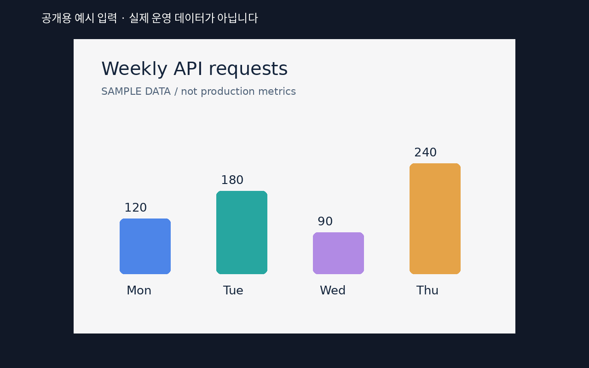

# On-Premises LLM Serving Platform

자체 인프라에서 AI 모델을 **OpenAI 호환 API**로 제공하고 **Control Plane**에서 운영하는 플랫폼입니다. 모델 상태와 요청을 확인하고, 지원되는 환경에서는 모델 전환과 GPU 자원을 관리합니다.

**Self-hosted · Linux/NVIDIA · Apple Silicon**

[빠른 시작](#quick-start) · [배포 환경](#deployment-targets) · [역할별 이용 안내](#usage-guides) · [개발자 가이드](docs/guides/developer-guide.md)

<a id="quick-start"></a>

## 빠른 시작

Git, Python·uv, Docker와 해당 환경의 모델 실행 자원이 필요합니다. 설치 조건은 [빠른 시작 가이드](docs/guides/getting-started.md)를 확인하세요.

```bash
git clone https://github.com/so9093-K/On-Premises-LLM-Serving-Platform.git
cd On-Premises-LLM-Serving-Platform
```

**Linux / 기본 서비스 (GPU 및 모델 불필요)**

```bash
make up TARGET=linux-core ACCESS=local
```

Gateway, Control Plane, Scalar, PII·Secret Risk Service를 실행합니다. `/ready`는
활성 모델 대신 Core 서비스의 준비 상태를 검사하며, Chat/Responses 요청은
`MODEL_UNAVAILABLE`로 거부합니다. GPU가 존재해도 자원이 부족하면 이 구성을
사용할 수 있습니다. GPU 모델을 자동으로 중지하거나 CPU 모델로 전환하지 않습니다.

**Linux / CPU 추론 (외부 llama.cpp Server 필요)**

```bash
make up TARGET=linux-cpu-static ACCESS=local MAIN_URL=http://host.docker.internal:8080/v1
```

먼저 CPU-only `llama-server`를 실행하고, Gateway가 위 주소에 접근할 수 있게 구성해야 합니다.
모델은 운영자가 다운로드·검증하며 Gateway는 외부 Runtime의 lifecycle을 소유하지 않습니다.
`configs/cpu_main_model_profiles.yaml`의 Text Chat·Streaming Profile은 아직 실환경 검증 전입니다.
GPU 자원 부족 시 자동 Fallback이나 Target 전환은 지원하지 않습니다.

**Linux / 관리형 CPU 모델 (llama.cpp)**

```bash
make up TARGET=linux-cpu-managed ACCESS=local
```

플랫폼이 고정된 Qwen3 0.6B GGUF를 다운로드하고 SHA-256으로 검증한 뒤
CPU-only llama.cpp 컨테이너를 실행합니다. GPU나 CUDA는 필요하지 않습니다.
모델 최초 다운로드에는 네트워크 연결과 충분한 RAM·디스크 여유가 필요합니다.
GPU 모델에서의 자동 전환은 아직 수행하지 않으며, 서버 실추론 Qualification 전까지
`unverified`로 유지합니다.

**Linux / NVIDIA** — 플랫폼이 관리하는 vLLM Runtime

```bash
make up TARGET=linux-nvidia-dynamic ACCESS=local
```

**macOS / Apple Silicon** — 별도로 관리하는 MLX-VLM Main Runtime

```bash
make up TARGET=macos-metal-static ACCESS=local
```

실행 후 `make status`로 준비 상태를 확인합니다. `ACCESS=local`은 같은 Host의 Loopback 접속입니다.

- **Control Plane:** `http://127.0.0.1:9400/admin/console/`
- **Gateway:** `http://127.0.0.1:9400`

모델이 준비됐다면 로컬 기본 인증 설정에서 API를 호출할 수 있습니다.

```bash
curl --fail-with-body -sS http://127.0.0.1:9400/v1/chat/completions \
  -H "Content-Type: application/json" \
  -d '{
    "model": "local-main",
    "messages": [{"role": "user", "content": "안녕하세요"}],
    "max_tokens": 128
  }'
```

인증이 활성화된 환경에서는 사용자 API Key가 필요합니다. 일상 운영은 `make up` · `make status` · `make logs` · `make down`을 사용합니다. 모델 접근 승인, `HF_TOKEN`, GPU 자원 설정은 [설치 가이드](docs/guides/getting-started.md)를 참고하세요.

## 시스템 구성


애플리케이션은 Gateway를 통해 모델 API를 호출합니다. Linux/NVIDIA의 Managed Runtime은 모델 실행·전환과 GPU 자원 제어를 제공하며, Static Target의 Main Runtime은 외부에서 관리합니다.

[시스템 구성](docs/03_system_components.md) · [OpenAI 호환 범위](docs/reference/openai_compatibility.md)

## Control Plane


*운영 개요*


*Playground · 모델 응답*

모델 상태·요청 지표를 조회하고, Playground에서 모델 요청과 코드 내보내기를 수행할 수 있습니다. 지원되는 Managed Target에서는 Runtime 제어와 모델 전환 영향 검토도 제공합니다.

[Control Plane 사용법](docs/guides/user-guide.md) · [모델 운영](docs/06_model_operations.md)

## 기능 데모



*이미지 분석 · 그래프의 최대·최소값*

[이미지 분석](docs/reference/feature_demos.md#image-analysis) · [OCR](docs/reference/feature_demos.md#ocr) · [시스템 프롬프트 입력](docs/reference/feature_demos.md#system-prompt) · [임베딩·유사도](docs/reference/feature_demos.md#embedding)

## Scalar API Reference


*Scalar API Reference*

Gateway의 `/docs`에서 API 요청 스키마·예제·테스트 요청을 확인할 수 있습니다. 문서 화면의 제공 여부는 접근 설정에 따릅니다.

[API Reference](docs/reference/api_reference.md) · [OpenAPI 계약](specs/openapi.gateway.yaml)

<a id="deployment-targets"></a>

## 배포 환경

| Target | 모델 실행 | 지원 기능 | 운영 주체 |
|---|---|---|---|
| `linux-core` | 없음 | Gateway·Control Plane·PII/Secret Risk | 기본 서비스만 실행 |
| `linux-cpu-static` | 외부 llama.cpp CPU Runtime | Text Chat·Responses, PII·Secret Risk | 외부 모델 서버 · 미검증 |
| `linux-nvidia-dynamic` | vLLM | Chat·Responses, Embedding·Retrieval, Risk | 플랫폼 관리 · 모델 전환·GPU 제어 |
| `linux-nvidia-static` | 외부 vLLM | Chat·Responses, PII·Secret Risk | 외부 Main Runtime |
| `macos-metal-static` | MLX-VLM | Chat·Responses, PII·Secret Risk | 외부 Main Runtime |

기능별 지원·검증 상태와 모델 자원 조건은 [Deployment Target](configs/deployment_targets.yaml) 및 [모델 운영](docs/06_model_operations.md)을 참고하세요.

<a id="usage-guides"></a>

## 역할별 이용 안내

이미 구성된 플랫폼에 **외부 기기에서 접속하는 사용자**는 저장소 설치나 서버의 `make` 명령이 필요하지 않습니다. 운영자가 전달한 실제 주소와 권한을 사용합니다.

- **외부 관리자:** 승인된 Tailnet에서 Control Plane에 접속하고 Admin Key로 인증합니다. [관리자 접속 가이드](docs/guides/remote-access.md#external-admin)
- **외부 API 사용자:** 운영자가 제공하는 API Base URL과 사용자 API Key로 모델을 호출합니다. [API 연동 가이드](docs/guides/api-integration.md#remote-api)
- **서버 운영자:** 원격 접속이 필요한 경우 `ACCESS=edge`와 별도 Tailscale·Nginx 설정을 검토합니다. [Host 설정·해제 가이드](docs/guides/remote-access.md#operator-setup)

원격 접속은 **일반 인터넷 공개가 아닌 선택적 Tailnet 접속**입니다. Host 설정 가이드는 Ubuntu/Linux 기준이며 macOS Host의 동일한 원격 구성은 아직 실환경 검증되지 않았습니다.

## 문서

[가이드 목차](docs/guides/README.md) · [기술 문서](docs/README.md) · [기여 안내](CONTRIBUTING.md) · [변경 이력](CHANGELOG.md)

## 라이선스

직접 작성한 소스 코드·문서·설정은 별도 표시가 없는 한 [Apache License 2.0](LICENSE)을 따릅니다. 제3자 소프트웨어와 모델 가중치는 각 원저작자의 라이선스 및 이용 약관을 따릅니다. [제3자 고지](NOTICE)
