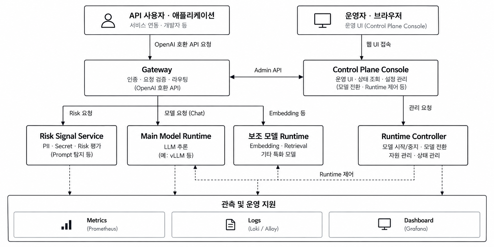
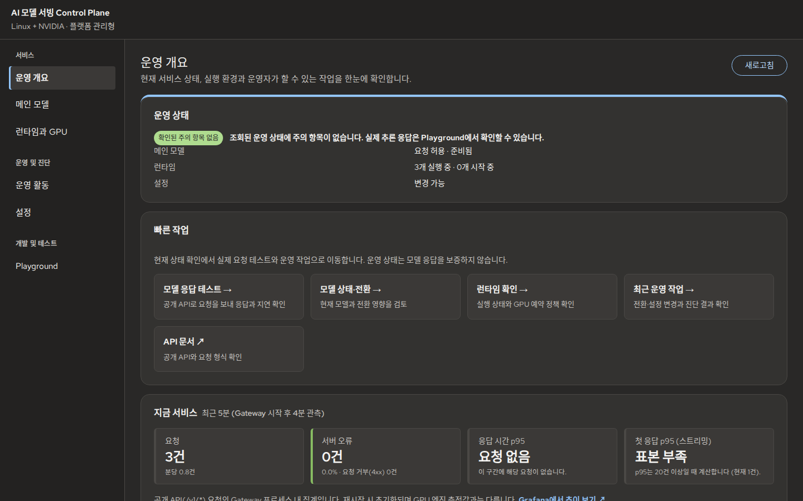
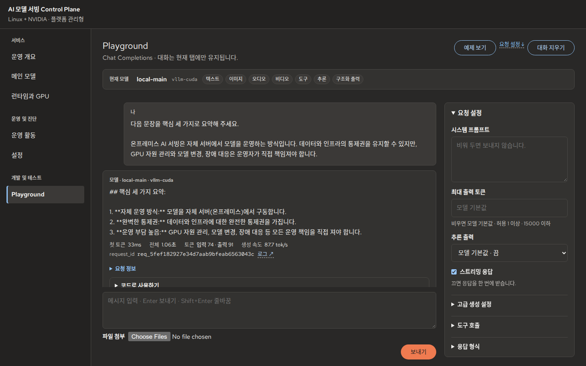
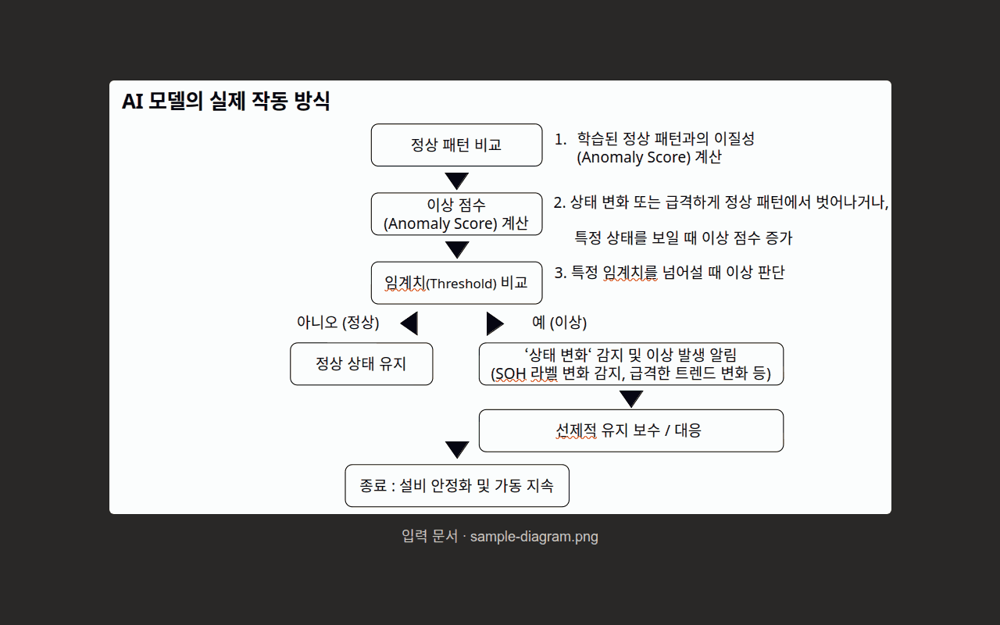

# On-Premises LLM Serving Platform

자체 인프라에서 AI 모델을 **OpenAI 호환 API**로 제공하고 **Control Plane**에서 운영하는 플랫폼입니다. 모델 상태와 요청을 확인하고, 지원되는 환경에서는 모델 전환과 GPU 자원을 관리합니다.

**Self-hosted · Linux/NVIDIA · Apple Silicon**

[빠른 시작](#quick-start) · [배포 환경](#deployment-targets) · [역할별 이용 안내](#usage-guides) · [개발자 가이드](docs/guides/developer-guide.md)

<a id="quick-start"></a>

## 빠른 시작

Python·uv, Docker가 필요합니다. 소스는 [ZIP 다운로드](https://github.com/so9093-K/On-Premises-LLM-Serving-Platform/archive/refs/heads/main.zip) 또는 Git으로 준비합니다. 환경별 준비 조건과 모델 권한·자원 설정은 [빠른 시작 가이드](docs/guides/getting-started.md)를 확인하세요.

압축을 풀거나 복제한 소스의 `Makefile`이 있는 디렉터리에서 실행합니다.

```bash
make up TARGET=linux-core ACCESS=local
make status
```

위 명령은 모델 없이 기본 서비스를 시작합니다. 모델을 실행하려면 환경에 맞는 Target으로 바꿔 실행하세요.

| 내 환경 | `TARGET` |
|---|---|
| GPU·모델 없이 기본 서비스만 (Gateway·Control Plane·PII/Secret Risk) | `linux-core` |
| Linux, GPU 우선·CPU 복구 (GPU 복귀는 수동) | `auto` |
| macOS Apple Silicon (MLX-VLM) | `macos-metal-static` |

외부 llama.cpp·관리형 CPU·외부 vLLM 연결은 [배포 환경](#deployment-targets)과 [빠른 시작 가이드](docs/guides/getting-started.md#1-실행-환경-선택)를 참고하세요.

준비되면 Control Plane `http://127.0.0.1:9400/admin/console/`에서 상태와 Playground를 확인하고, Gateway `http://127.0.0.1:9400`으로 OpenAI 호환 API를 호출합니다.

모델 없이도 PII 탐지를 확인할 수 있습니다.

```bash
curl -sS http://127.0.0.1:9400/v1/risk/detectors/pii/assessments -H "Content-Type: application/json" \
  -d '{"prompt": "Contact hong@example.com."}'
```

Chat 요청은 Main Runtime이 준비된 Target에서 실행합니다.

```bash
curl -sS http://127.0.0.1:9400/v1/chat/completions -H "Content-Type: application/json" \
  -d '{"model": "local-main", "messages": [{"role": "user", "content": "안녕하세요"}], "max_tokens": 128}'
```

기본 포트 대역은 `9400`입니다(Gateway 9400, Grafana 9410). 다른 대역을 쓰려면 첫 설치는 `make up TARGET=<deployment-target> PORTS=9600`, 설치된 환경은 `make ports BASE=9600` 후 `make up`으로 적용합니다. 내부 서비스 포트와 모니터링 설정도 같은 대역으로 바뀌며 소스 수정이나 개발 도구가 필요하지 않습니다. [포트 대역 변경](docs/12_operations.md#포트-대역-변경과-기존-캐시)을 참고하세요.

일상 운영은 `make up` · `make status` · `make logs` · `make down`을 사용합니다. 인증이 활성화된 환경에서는 사용자 API Key가 필요합니다.

## 시스템 구성



애플리케이션은 Gateway를 통해 모델 API를 호출합니다. Linux/NVIDIA의 Managed Runtime은 모델 실행·전환과 GPU 자원 제어를 제공하며, Static Target의 Main Runtime은 외부에서 관리합니다.

[시스템 구성](docs/03_system_components.md) · [OpenAI 호환 범위](docs/reference/openai_compatibility.md)

## Control Plane



*운영 개요*



*Playground · 모델 응답*

모델 상태·요청 지표를 조회하고, Playground에서 배포가 제공하는 Chat·Embedding·문서 관련도 순위·Risk 요청과 코드 내보내기를 수행할 수 있습니다. 지원되는 Managed Target에서는 Runtime 제어와 모델 전환 영향 검토도 제공합니다.

[Control Plane 사용법](docs/guides/user-guide.md) · [모델 운영](docs/06_model_operations.md)

## 기능 데모



*문서 해석 · 흐름도의 판단 단계와 분기 정리*

[문서 해석](docs/reference/feature_demos.md#document-analysis) · [이미지 분석](docs/reference/feature_demos.md#image-analysis) · [OCR](docs/reference/feature_demos.md#ocr) · [영상 분석](docs/reference/feature_demos.md#video-analysis) · [시스템 프롬프트 입력](docs/reference/feature_demos.md#system-prompt) · [임베딩·문서 순위](docs/reference/feature_demos.md#embedding)

## Scalar API Reference


*Scalar API Reference*

Gateway의 `/docs`에서 API 요청 스키마·예제·테스트 요청을 확인할 수 있습니다. 문서 화면의 제공 여부는 접근 설정에 따릅니다.

[API Reference](docs/reference/api_reference.md) · [OpenAPI 계약](specs/openapi.gateway.yaml)

<a id="deployment-targets"></a>

## 배포 환경

| Target | 모델 실행 | 지원 기능 | 운영 주체 |
|---|---|---|---|
| `linux-core` | 없음 | Gateway·Control Plane·PII/Secret Risk | 기본 서비스만 실행 |
| `linux-cpu-static` | 외부 llama.cpp CPU Runtime | Text Chat·Responses, PII·Secret Risk | 외부 모델 서버 · 미검증 |
| `linux-nvidia-dynamic` | vLLM GPU / llama.cpp CPU · 자동 또는 고정 정책 | 활성 모델별 Chat·Responses, Embedding·Retrieval, Risk | 플랫폼 관리 · 모델 전환·GPU 제어 |
| `linux-nvidia-static` | 외부 vLLM | Chat·Responses, PII·Secret Risk | 외부 Main Runtime |
| `macos-metal-static` | MLX-VLM | Chat·Responses, PII·Secret Risk | 외부 Main Runtime |

관리형 CPU는 `make up TARGET=linux-nvidia-dynamic POLICY=cpu ACCESS=local`으로 시작합니다. 같은 Runtime Controller가 CPU/GPU 모델 변경과 서버 문맥·출력 한도를 관리합니다.

기능별 지원·검증 상태와 모델 자원 조건은 [Deployment Target](configs/deployment_targets.yaml) 및 [모델 운영](docs/06_model_operations.md)을 참고하세요.

<a id="usage-guides"></a>

## 역할별 이용 안내

이미 구성된 플랫폼에 **외부 기기에서 접속하는 사용자**는 저장소 설치나 서버의 `make` 명령이 필요하지 않습니다. 운영자가 전달한 실제 주소와 권한을 사용합니다.

- **외부 관리자:** 승인된 Tailnet에서 Control Plane에 접속하고 Admin Key로 인증합니다. [관리자 접속 가이드](docs/guides/remote-access.md#external-admin)
- **외부 API 사용자:** 운영자가 제공하는 API Base URL과 사용자 API Key로 모델을 호출합니다. [API 연동 가이드](docs/guides/api-integration.md#remote-api)
- **서버 운영자:** 원격 접속이 필요한 경우 `ACCESS=edge`와 별도 Tailscale·Nginx 설정을 검토합니다. [Host 설정·해제 가이드](docs/guides/remote-access.md#operator-setup)

원격 접속은 **일반 인터넷 공개가 아닌 선택적 Tailnet 접속**입니다. Host 설정 가이드는 Ubuntu/Linux 기준이며 macOS Host의 동일한 원격 구성은 아직 실환경 검증되지 않았습니다.

## 문서

[가이드 목차](docs/guides/README.md) · [기술 문서](docs/README.md) · [기여 안내](CONTRIBUTING.md) · [변경 이력](CHANGELOG.md)

## 라이선스

직접 작성한 소스 코드·문서·설정은 별도 표시가 없는 한 [Apache License 2.0](LICENSE)을 따릅니다. 제3자 소프트웨어와 모델 가중치는 각 원저작자의 라이선스 및 이용 약관을 따릅니다. [제3자 고지](NOTICE)
