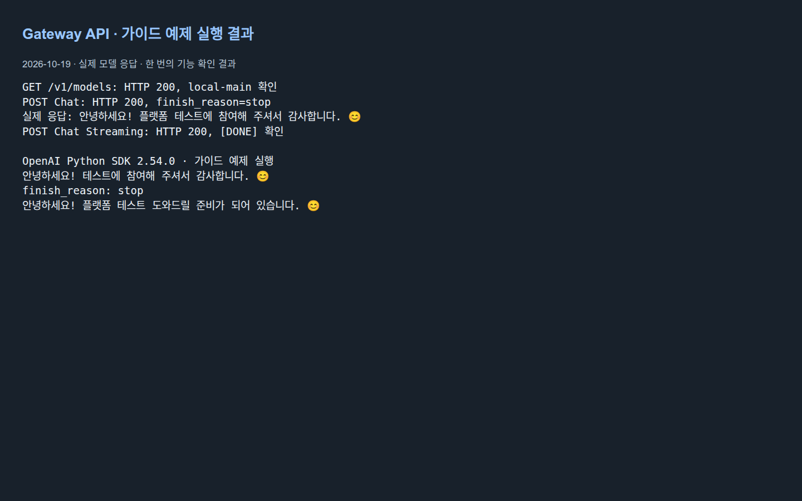
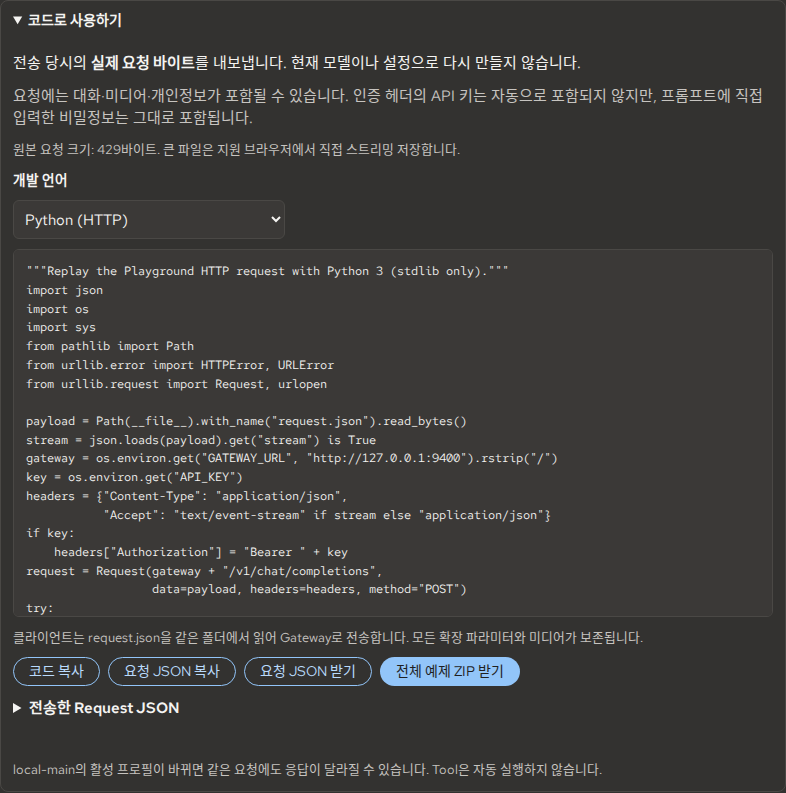

# API 연동 가이드

플랫폼 API를 소비하는 애플리케이션 개발자를 위한 절차입니다.
플랫폼 설치는 [빠른 시작](getting-started.md), 저장소 수정은 [개발자 가이드](developer-guide.md)를 따릅니다.
요청 필드·오류·지원 범위의 기준은 [API Reference](../reference/api_reference.md),
[OpenAI 호환 범위](../reference/openai_compatibility.md), [OpenAPI](../../specs/openapi.gateway.yaml)입니다.

<a id="remote-api"></a>

## 외부 기기에서 API를 사용한다면

서버 운영자가 이미 구성한 **팀원 API 전용 HTTPS 주소**를 사용합니다. **사용자 기기에 이 저장소를 설치하거나 `make` 명령을 실행할 필요는 없습니다.**

1. 운영자에게 본인의 Tailscale 접속 권한(HTTPS 8443), **API Base URL**, **사용자 API Key**, 모델 별칭을 요청합니다.
2. 본인의 기기에서 Tailscale에 로그인·연결합니다. 주소 형식은 `https://<실제-서버-tailnet-이름>:8443`이며, 실제 서버 주소는 운영자가 확인해 전달합니다.
3. 아래 `GATEWAY_URL`을 **운영자가 전달한 주소**로 설정한 뒤 이 문서의 `/v1/models` 및 Chat 예제를 실행합니다.

```bash
# 외부 기기용: 실제 운영자가 제공한 값으로 교체
export GATEWAY_URL="https://<실제-서버-tailnet-이름>:8443"
read -r -s -p '사용자 API Key: ' API_KEY
printf '\n'
export API_KEY
AUTH=(-H "Authorization: Bearer $API_KEY")
curl --fail-with-body "$GATEWAY_URL/v1/models" "${AUTH[@]}"
```

위 주소는 **Gateway Base URL**이므로 `/v1`은 요청 경로 또는 SDK의 `base_url`에 한 번만 추가합니다. HTTPS 8443은 `GET /v1/models`와 허용된 Chat·Responses·Embeddings 경로만 제공하며, 관리자 Control Plane·`/docs`·`/metrics`는 제공하지 않습니다.
Key를 URL이나 공유 문서에 넣지 말고 안전한 경로로 수령하세요. 연결 실패는 Tailscale·주소·8443 Grants, `401`은 일반 사용자 API Key, `404`는 허용된 API 경로를 운영자에게 확인합니다.
[외부 API 접속 안내](remote-access.md#external-api)와 [서버 운영자 설정](remote-access.md#operator-setup)은 다른 절차입니다.

---

## 1. Gateway 연결·모델 조회

**준비:** 운영자로부터 Gateway 주소와 필요한 경우 **사용자 API Key**를 받습니다. 로컬 서버와 동일한 기기에서는 아래 Loopback 기본값을 사용하고, 외부 기기에서는 위의 HTTPS 8443 주소를 사용하세요.
아래 shell 예제는 Bash와 curl 7.76 이상을 사용합니다. Admin Key·내부 token·Hugging Face token은 사용하지 않습니다.

```bash
# 동일 서버에서만 사용하는 로컬 예시
export GATEWAY_URL=http://127.0.0.1:9400
AUTH=()
```

인증이 필요한 배포에서만 다음을 실행합니다. `API_KEY`는 아래 SDK 예제에서도 사용합니다.

```bash
read -r -s -p '사용자 API Key: ' API_KEY
printf '\n'
export API_KEY
AUTH=(-H "Authorization: Bearer $API_KEY")
```

```bash
curl --fail-with-body "$GATEWAY_URL/v1/models" "${AUTH[@]}"
```

`data`에서 `local-main`의 `input_modalities`, `capabilities`, `request_parameters`를 읽습니다.
이 alias는 활성 Main Model을 가리키므로 전환 뒤에도 같은 alias가 다른 모델을 의미할 수 있습니다.
모델 목록은 catalog 조회이며 실제 Runtime 준비 상태를 보장하지 않습니다.
`/docs`는 문서 공개가 허용된 Access Profile에서만 이용할 수 있습니다. 팀원 API용 HTTPS 8443 및 `ACCESS=edge`에서는 사용할 수 없습니다.


*API 문서 화면 (이전 UI)*

**성공 기준:** 200 응답과 사용할 모델의 입력·요청 제한을 확인합니다.
**실패 시:** 접속 불가는 주소·네트워크, 401은 사용자 API Key와 접근 설정을 운영자에게 확인합니다.

## 2. 요청·스트리밍

**준비:** 위 주소·인증 설정, 준비된 Main Model이 필요합니다.

공개용 짧은 입력으로 시작합니다. 임의의 실제 응답이나 응답 시간을 예시로 만들지 않습니다.

```bash
curl --fail-with-body "$GATEWAY_URL/v1/chat/completions" "${AUTH[@]}" \
  -H 'Content-Type: application/json' \
  --data-binary '{"model":"local-main","messages":[{"role":"user","content":"플랫폼 테스트입니다. 짧게 인사해 주세요."}],"stream":false}'
```

응답의 `choices[0].message.content`, `finish_reason`, `usage`와 request ID를 확인합니다.
Streaming은 같은 endpoint에서 `stream:true`로 요청합니다.

```bash
curl --fail-with-body --no-buffer "$GATEWAY_URL/v1/chat/completions" "${AUTH[@]}" \
  -H 'Content-Type: application/json' \
  --data-binary '{"model":"local-main","messages":[{"role":"user","content":"플랫폼 테스트입니다. 짧게 인사해 주세요."}],"stream":true}'
```

**성공 기준:** 일반 요청은 오류 없는 JSON 응답, 스트림은 정상 이벤트와 최종 `data: [DONE]`을 확인합니다.
`finish_reason=length`는 출력 한도 종료이므로 답변이 충분한지도 별도 판단합니다.
**실패 시:** HTTP 200으로 열린 SSE 안에서도 오류가 올 수 있습니다. curl의 종료 코드 0만으로
성공을 판단하지 말고 오류 이벤트와 `[DONE]` 누락을 확인하세요. 애플리케이션 재현에는 아래 Exact Replay를 사용할 수 있습니다.

## 3. OpenAI Python SDK

**준비:** 위 환경변수와 Python 환경이 필요합니다. 저장소의 `make setup-dev` 환경에는
`pyproject.toml`에 고정된 SDK가 포함됩니다. 별도 프로젝트에서는 자체 가상환경에서 `pip install openai`를 실행합니다.

다음을 `gateway_chat.py`로 저장해 해당 환경의 Python으로 실행합니다.

```python
import os
from openai import OpenAI

client = OpenAI(
    base_url=os.environ["GATEWAY_URL"].rstrip("/") + "/v1",
    api_key=os.environ.get("API_KEY") or "local-no-auth",
    max_retries=0,
    timeout=120.0,
)
messages = [{"role": "user", "content": "플랫폼 테스트입니다. 짧게 인사해 주세요."}]
reply = client.chat.completions.create(model="local-main", messages=messages)
print(reply.choices[0].message.content)
print("finish_reason:", reply.choices[0].finish_reason)

with client.chat.completions.create(
    model="local-main", messages=messages, stream=True,
) as stream:
    for chunk in stream:
        for choice in chunk.choices:
            print(choice.delta.content or "", end="", flush=True)
print()
client.close()
```

`local-no-auth`는 SDK 생성에 필요한 비어 있지 않은 값입니다. 실제 인증 배포에서는
운영자가 발급한 `API_KEY`가 필수입니다. `base_url`에는 `/v1`을 한 번만 붙입니다.
일반 응답과 stream iterator 사용법은 [공식 Python Chat Completions 문서](https://developers.openai.com/api/reference/python/resources/chat/subresources/completions/methods/create)를 참고합니다.
이 플랫폼이 허용하는 필드는 위의 프로젝트 호환 범위가 소유합니다.

**성공 기준:** 일반·스트리밍 호출에서 실제 모델 응답을 받습니다.
**실패 시:** SDK 예외·Gateway 오류를 확인합니다. SDK iterator 종료만으로 원본 SSE의 `[DONE]`까지
검증했다고 간주하지 않습니다. 전송 바이트와 종료 검증은 아래 Exact Replay 경로를 사용하세요.
확장 필드는 Python SDK의 `extra_body`로 전달하며, 모델이 공개하지 않은 옵션을 임의로 추가하지 않습니다.



*API·SDK 호출 결과*

<a id="replay"></a>

## 4. Playground 요청 재현

**준비:** Playground에서 실제 요청을 한 번 보내고 결과를 확인합니다.

1. 해당 응답의 **코드로 사용하기**를 엽니다.
2. 요청 JSON과 코드 미리보기를 확인하고 **전체 예제 ZIP 받기**를 선택합니다.
3. ZIP을 별도 작업 디렉터리에 풀고 `README.md`를 읽습니다. 원본 HTTP 재현은 `client.py`·`client.mjs`·`client.sh`,
   SDK 통합은 `client_openai.py`·`client_openai.mjs`입니다.
4. 위와 같이 `GATEWAY_URL`과 필요한 `API_KEY`를 설정하고 한 가지 클라이언트를 실행합니다.



*Playground · 요청 내보내기*

```bash
python3 client.py
```

**성공 기준:** 전송 당시 `request.json`을 사용한 재현이 정상 종료됩니다.
Exact Replay는 SSE 오류·`[DONE]` 누락을 실패로 처리합니다. SDK 통합 예제는 전송 바이트 동일성을 보장하지 않습니다.
**실패 시:** 원래 요청도 실패·중지 상태였는지, 모델이 바뀌었는지, 입력 제한·Gateway 주소가 맞는지 확인합니다.

요청은 전송 시점 기준입니다. 이후 Playground 편집 내용은 해당 Receipt를 바꾸지 않습니다.
ZIP에 인증 키는 자동 포함되지 않지만 프롬프트·대화 이력·미디어는 포함됩니다.
다운로드 파일은 직접 보관·삭제하고 공유 전 내용을 검토하세요.
대용량 파일의 저장 제한과 환경별 조건은 [요청 재현 Reference](../reference/playground_integration.md)가 소유합니다.

## 5. 추가 기능·오류 처리

이미지·오디오·Tool·JSON Schema는 `/v1/models`의 현재 지원 범위에서만 사용합니다.
이미지 분석·OCR·시스템 프롬프트·임베딩의 [실제 GIF](../reference/feature_demos.md)는
입력과 촬영 조건을 함께 제공합니다. 시스템 프롬프트 사례를 Prompt Injection Detector의 탐지 성능으로 해석하지 않습니다.
Embedding·Retrieval은 target capability와 해당 Runtime 준비 상태를 모두 확인하세요.
Responses API는 별도 이벤트 계약이므로 Chat SSE 파서를 재사용하기 전에 [API Reference](../reference/api_reference.md)를 확인합니다.

오류는 HTTP status와 응답의 `error.code`·request ID를 함께 기록합니다.
401은 인증, 422는 입력 계약, 409 `DETECTOR_DISABLED`는 비활성 탐지 기능을 먼저 확인합니다.
5xx·스트림 중단은 [운영자 복구 절차](user-guide.md#recovery)로 전달합니다.
재시도는 오류의 retryable 의미와 작업 중복 영향을 검토한 뒤 애플리케이션에서 결정합니다.
