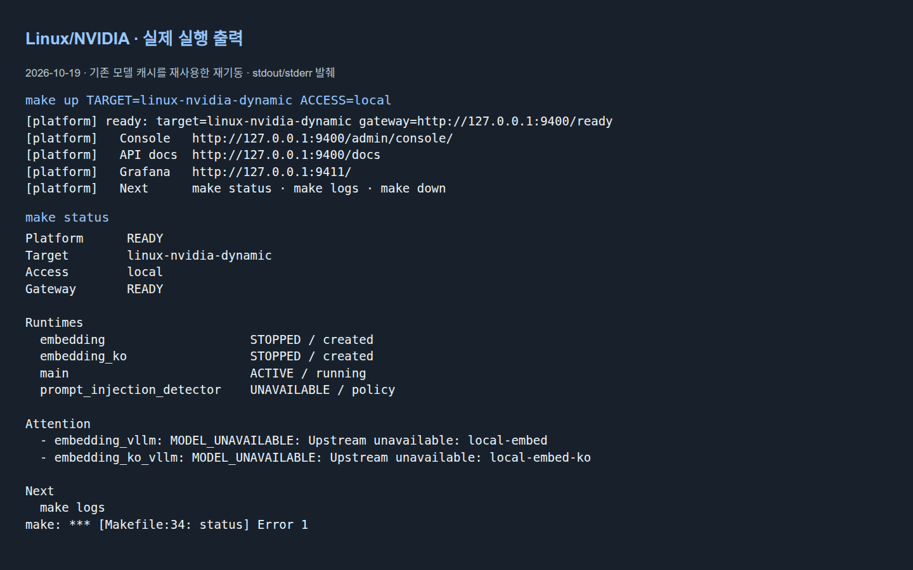
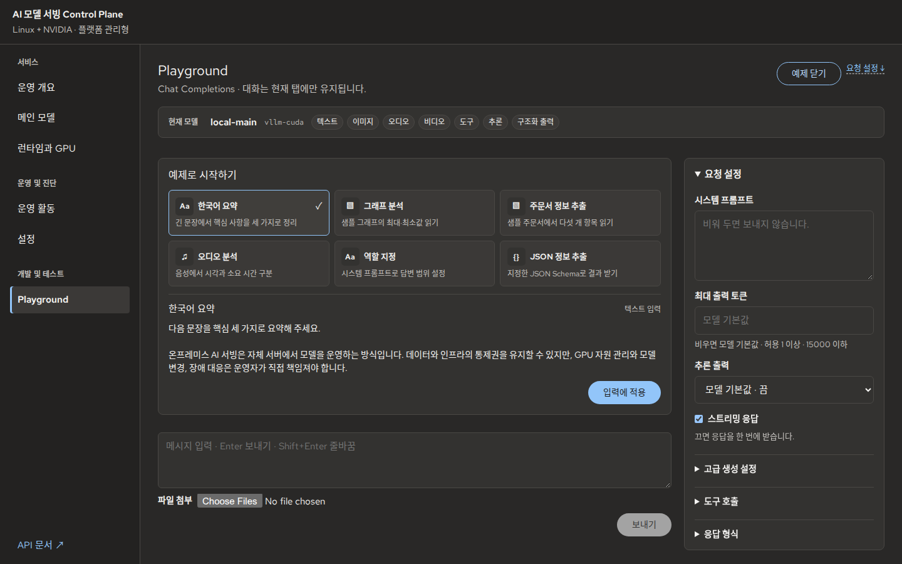

# 빠른 시작


**준비:** 저장소를 내려받은 호스트에서 작업합니다. 아래 명령은 저장소 루트 기준이며
Python·uv·Docker, 모델 접근 권한과 선택한 프로필에 충분한 메모리가 필요합니다.
이미 운영 중인 설치에서는 기존 `.env`와 모델 상태를 기준으로 동작합니다.

아직 저장소가 없다면 먼저 내려받습니다.

```bash
git clone https://github.com/so9093-K/On-Premises-LLM-Serving-Platform.git
cd On-Premises-LLM-Serving-Platform
```

Git을 사용하지 않는다면 GitHub의 **Code → Download ZIP**으로 내려받아 압축을 풀고,
`Makefile`이 있는 디렉터리에서 아래 명령을 실행합니다. Git 설치와 `.git` 정보는
플랫폼 기동·상태 확인·종료·포트 변경의 필수 조건이 아닙니다. Git 소유권 검사에
실패해도 실행을 위해 전역 `safe.directory` 설정을 바꿀 필요는 없습니다.

## 1. 실행 환경 선택

| 내 환경 | 선택할 Target | 먼저 준비할 것 | 모델 실행·제어 |
|---|---|---|---|
| Linux · GPU·모델 없이 기본 서비스 | `linux-core` | Python 3.12–3.13, uv, Docker | 모델 Runtime 없음. Gateway·Control Plane·Scalar·PII/Secret Risk만 실행 |
| Linux · 관리형 CPU 모델 | `linux-cpu-managed` | Python 3.12–3.13, uv, Docker, 모델 다운로드용 네트워크와 RAM·디스크 여유 | 플랫폼이 고정 GGUF와 llama.cpp CPU 컨테이너 관리, `unverified` |
| Linux · 외부 llama.cpp CPU 서버 | `linux-cpu-static` | Python 3.12–3.13, uv, Docker, 실행 중인 CPU-only `llama-server` | Main lifecycle은 외부 관리, `unverified` |
| Linux · CPU/GPU 자동 선택 | `linux-adaptive` 또는 최초 `auto` | Python 3.12–3.13, uv, Docker, CPU 여유 RAM 4 GiB 이상; GPU 사용 시 Driver·Toolkit·모델 권한 | [CPU 복구·GPU 복귀](adaptive-runtime.md) |
| Linux amd64 + NVIDIA | `linux-nvidia-dynamic` | Python 3.12–3.13, uv, Docker, NVIDIA driver·Container Toolkit, Bash 4+ | 플랫폼이 vLLM lifecycle과 GPU admission 관리 |
| Apple Silicon | `macos-metal-static` | Python 3.13.12, uv, Docker, 모델에 충분한 unified memory | native MLX-VLM, Main lifecycle은 외부 관리 |
| Linux + 이미 실행 중인 외부 Main | `linux-nvidia-static` | Python 3.12–3.13, uv, Docker, 접근 가능한 Main endpoint와 맞는 profile | Main lifecycle은 외부 관리; target qualification은 `unverified` |

전체 기능과 선언은 [Deployment Target](../../configs/deployment_targets.yaml)이 소유합니다.
모든 Target은 PII·Secret Risk를, 모델 Runtime이 있는 Target은 Chat/Responses를 제공하고,
Embedding·Retrieval·모델 기반 Prompt Injection Detector는 `linux-nvidia-dynamic`의 범위입니다.
Adaptive는 Main 자동 선택과 로컬 Risk를 제공합니다.
리소스 정책에 따라 일부 supporting Runtime은 제외될 수 있습니다.

Linux에서는 다음으로 장치와 Docker 접근을 먼저 확인합니다.

```bash
python3 --version
uv --version
docker info
nvidia-smi
```

uv 허용 범위는 [pyproject.toml](../../pyproject.toml)의 `tool.uv.required-version`,
native MLX의 고정 환경은 [실행 모드](../04_runtime_modes.md)를 확인하세요.
GPU가 보인다는 것만으로 모델이 메모리에 들어가는 것은 아닙니다. 기본 프로필의 reference policy가
호스트에 맞는지 [모델 운영의 자원 정책](../06_model_operations.md)을 먼저 확인하세요.
특히 24GB 장비에서 기본값을 그대로 실행할 수 있다고 가정하지 마세요.
`MODEL`은 프로필 선택이며 VRAM 요구량을 자동으로 줄이는 옵션이 아닙니다.
필요한 `MAIN_MODEL_RESOURCE_VARIANT`는 사전에 검토한 `.env` 설정으로 지정합니다.
환경 예시 파일을 그대로 복사해 실제 인증값으로 사용하지 않습니다.

예를 들어 **RTX 4090 24GB에서 E4B를 처음 설치**한다면, 기존 `.env`가 없는 상태에서
아래처럼 환경을 생성하고 편집기로 `.env`의 `MAIN_MODEL_RESOURCE_VARIANT` 값을
`rtx4090-24gb`로 설정한 뒤 다음 단계로 진행합니다. 다른 GPU에 같은 variant를 무조건 적용하지 않습니다.

```bash
make setup-dev
.venv/bin/python scripts/config/setup_env.py --profile compose \
  --deployment-target linux-nvidia-dynamic --main-profile gemma4-e4b-it --access-profile local
```

기존 설치는 생성기를 `--force`로 실행하지 말고 현재 profile·state와 맞는지 먼저 검토하세요.
이 예시는 해당 profile의 검토된 정책을 선택하는 절차이며 모든 동시 Runtime의 상주를 보장하지 않습니다.

## 2. 플랫폼 실행

선택한 모델 프로필이 호스트의 자원 정책에 맞는 경우 아래에서 **해당 환경 하나만** 실행합니다.

Linux/NVIDIA managed:

```bash
make up TARGET=linux-nvidia-dynamic ACCESS=local
```

Apple Silicon:

```bash
make up TARGET=macos-metal-static ACCESS=local
```

모델 접근 승인이 필요한 경우 Hugging Face에서 해당 모델의 이용 조건에 동의하고 token을 준비하세요.
예를 들어 Bash에서 다음처럼 화면에 값을 표시하지 않고 전달할 수 있습니다.

```bash
read -r -s -p 'Hugging Face token: ' HF_TOKEN
printf '\n'
export HF_TOKEN
make up TARGET=linux-nvidia-dynamic ACCESS=local
unset HF_TOKEN
```

Mac에서는 같은 방식으로 token을 준비한 뒤 Mac용 명령을 실행합니다.
위 예시는 현재 shell에서 token을 전달합니다. `.env`에 token을 직접 저장해 운영한다면
그 파일 자체도 공유하지 마세요.
`make up`은 환경·설정·image·model cache·서비스 준비 상태를 수렴합니다.
최초 실행의 다운로드·빌드는 오래 걸릴 수 있고, 이후에도 source 변경 시 다시 빌드할 수 있습니다.
고정된 설치 시간을 약속하지 않습니다.

GPU·모델 없이 기본 서비스만 실행한다면:

```bash
make up TARGET=linux-core ACCESS=local
```

`/ready`는 활성 모델 대신 Core 서비스의 준비 상태를 검사하며 Chat/Responses 요청은
`MODEL_UNAVAILABLE`로 거부합니다. Control Plane의 Playground → Risk에서 PII·Secret 탐지를 확인할 수 있습니다.
GPU가 있어도 자원이 부족하면 이 구성을 사용할 수 있으며, GPU 모델을 자동으로 중지하거나 CPU 모델로 전환하지 않습니다.

관리형 CPU 모델을 실행한다면:

```bash
make up TARGET=linux-cpu-managed ACCESS=local
```

플랫폼이 고정된 Qwen3 0.6B GGUF를 다운로드하고 SHA-256으로 검증한 뒤 CPU-only llama.cpp 컨테이너를
실행합니다. GPU나 CUDA는 필요하지 않습니다. 서버 실추론 Qualification 전까지 `unverified`이며
GPU 모델로의 자동 전환은 [자동 Runtime 운영](adaptive-runtime.md)의 `linux-adaptive`가 담당합니다.

외부 llama.cpp CPU 서버를 연결한다면, 먼저 CPU-only `llama-server`를 실행하고 Gateway가 접근할 수 있는 주소를 지정합니다:

```bash
make up TARGET=linux-cpu-static ACCESS=local MAIN_URL=http://host.docker.internal:8080/v1
```

모델 다운로드·검증과 Runtime lifecycle은 운영자가 소유합니다. `configs/cpu_main_model_profiles.yaml`의
Text Chat·Streaming Profile은 실환경 검증 전이며, GPU 자원 부족 시 자동 Fallback이나 Target 전환은 하지 않습니다.

외부 vLLM Runtime을 연결한다면:

```bash
make up TARGET=linux-nvidia-static MAIN_URL='http://<gateway에서-접근가능한-host>:8000/v1' ACCESS=local
```

`<...>`를 실제 endpoint로 바꿔야 합니다. Gateway 컨테이너의 `127.0.0.1`은 호스트의 loopback과
다르므로 호스트에서 호출되던 주소를 그대로 복사하지 마세요. 연결 경로와 profile 일치는
[실행 모드](../04_runtime_modes.md)에서 확인합니다.

`ACCESS=local`은 같은 컴퓨터의 loopback 접근입니다. LAN/VPN 또는 TLS edge 운영은
[사용자 가이드](user-guide.md#access-and-auth)의 접근 범위 절차를 따르세요.
기존 설치의 접근 범위 변경은 계획 검토와 `CONFIRM=access`가 필요할 수 있습니다.

## 3. 실행 상태 확인

`make up`이 종료 코드 0으로 끝나고 `ready`, Console/API docs 주소와 다음 명령을 출력하는지 봅니다.
그다음 다음 명령을 실행합니다.

```bash
make status
```

**성공 기준:** `Platform READY`, Gateway 준비 상태와 선택한 target을 확인합니다.
출력된 실제 주소를 우선 사용합니다. 기본 Console은 `http://127.0.0.1:9400/admin/console/`입니다.
`/health` 200은 프로세스 생존 확인이며 모델의 실제 응답 성공을 대신하지 않습니다.



*플랫폼 시작·상태 출력 (기존 캐시 재기동)*

이 실행에서는 Main이 `ACTIVE / running`이고, Embedding 2종은 `STOPPED / created`,
Prompt Injection Detector는 `UNAVAILABLE / policy`입니다. `Platform READY`여도
dependency의 주의 항목이 있으면 `make status`는 종료 코드 1을 반환할 수 있습니다.
이를 전체 Runtime 기동 성공으로 읽지 말고, 필요한 기능의 상태를 [사용자 가이드](user-guide.md#runtime-states)에서 구분하세요.

운영 개요에서 상태를 확인하세요.


*운영 개요*

## 4. Playground 첫 요청

1. Console에서 관리자 인증이 요구되면 운영자가 발급한 **Admin Key**를 입력합니다.
   `ACCESS=local`의 기본 설정에서는 인증 화면이 없을 수 있습니다.
2. **Playground**를 열고 현재 모델과 지원 기능을 확인합니다.
3. **한국어 요약** 예제를 선택해 **입력에 적용**합니다. 적용 자체는 추론을 실행하지 않습니다.
4. **보내기**를 누릅니다. 공개 API 인증이 요구되면 **사용자 API Key**를 입력합니다.
5. 응답 내용·request ID·종료 상태를 확인합니다.



*Playground · 예제 선택*


*Playground · 모델 응답*

**성공 기준:** 실제 응답이 도착하고 오류나 미완료 경고 없이 종료됩니다.
정확한 문구와 지연은 모델·입력·장비에 따라 달라집니다. 다음은 [사용자 가이드](user-guide.md)의
모델·GPU 운영 또는 [API 연동](api-integration.md)으로 진행하세요.

## 5. 문제 해결

```bash
make status
make logs
```

- 모델 다운로드의 401/403: 해당 모델 접근 승인과 Hugging Face token을 확인합니다.
- 메모리·profile 오류: 선택한 프로필과 resource variant를 확인합니다. 실패한 설정으로 반복 재시작하지 않습니다.
- API 401: Admin Key와 사용자 API Key를 구분하고 현재 접근 설정을 확인합니다.
- Runtime 중지/정책상 제외: [상태별 다음 행동](user-guide.md#runtime-states)을 확인합니다.

진단은 [사용자 가이드의 오류 복구](user-guide.md#recovery)에서 이어갑니다.
작업을 마칠 때는 `make down`으로 이 checkout의 실행 리소스를 정지합니다.
`make reset`·`make purge`는 각각 설정·state 초기화와 cache/artifact 삭제 절차이므로 일반 종료에 쓰지 않습니다.
