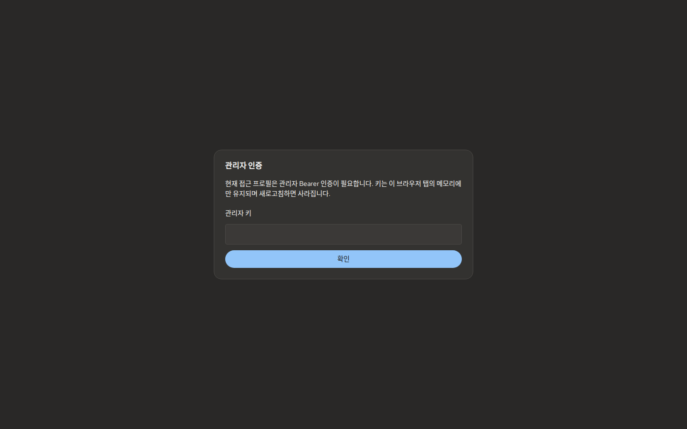
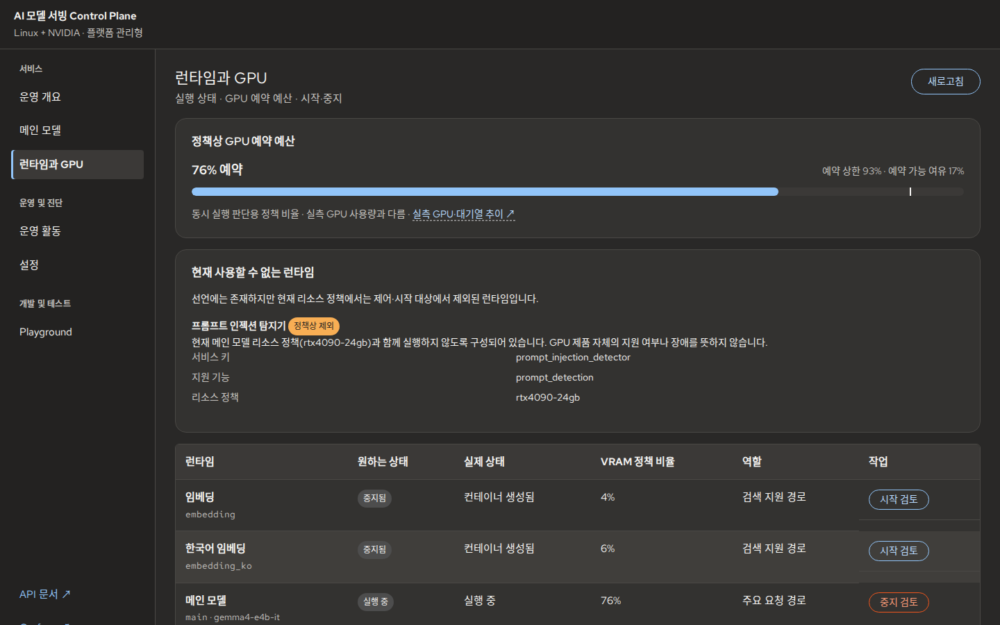
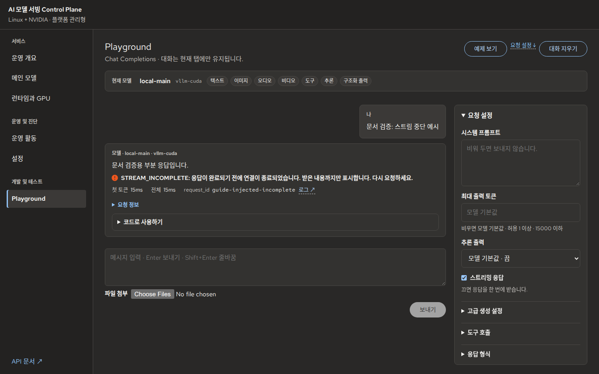

# 사용자 가이드

Control Plane 운영자를 위한 서비스 확인·모델 관리·복구 절차입니다. 최초 설치는 [빠른 시작](getting-started.md), 팀원 또는 앱의 모델 API 사용은 [API 연동](api-integration.md), 저장소 수정은 [개발자 가이드](developer-guide.md)를 참고하세요.

<a id="access-and-auth"></a>

## 1. 접근·인증

운영자가 안내한 Gateway 주소로 Console에 접속하고, 인증이 필요하면 **Admin Key**를 입력합니다. Playground의 모델 요청에는 별도 **사용자 API Key**가 필요할 수 있습니다. 키는 브라우저 탭 메모리에만 유지되며 새로고침 후 다시 입력해야 할 수 있습니다.

```bash
make status
make auth-status
```

`ACCESS=local`은 기본적으로 로컬 인증이 비활성이고, `private`는 신뢰된 LAN/VPN에서 인증을 요구합니다. `edge`는 Loopback Gateway 뒤에 별도의 TLS 프록시가 필요하며 인터넷 공개를 뜻하지 않습니다. 접속 모드 변경은 [접근 설정](../05_configuration.md), 개인·팀원 VPN 구성은 [원격 접속 가이드](remote-access.md)를 따르세요.



*관리자 인증*

401 오류는 키 종류·접근 정책을 확인하세요. **인증을 끄는 방식으로 우회하지 않습니다.**

## 2. 서비스 상태

1. **운영 개요**에서 메인 모델의 요청 Gate와 Runtime 상태를 확인합니다.
2. 최근 요청의 오류·지연을 확인합니다. 지표 조회 실패와 모델 장애를 구분합니다.
3. **모델 응답 테스트** 또는 **Playground**에서 실제 요청을 실행합니다.


*운영 개요*

**‘조회 결과 · 주의 없음’은 조회된 항목의 상태일 뿐 실제 추론 성공이나 무장애 보증이 아닙니다.** 문제가 있다면 [오류 복구](#recovery)에서 Request ID와 최근 작업을 확인하세요.

## 3. Playground

현재 모델이 Chat을 지원하고 요청 Gate가 열려 있어야 합니다.

1. 현재 모델과 지원 입력 기능을 확인합니다.
2. 예제를 미리 보고 **입력에 적용**합니다. 기존 내용 교체 확인이 나오면 검토합니다.
3. **보내기**로 요청을 실행하고 응답·Request ID를 확인합니다.
4. 필요하면 **중지**하고, 완료된 요청은 **코드로 사용하기**에서 내보냅니다. [API 요청 재현](api-integration.md#replay)을 참고하세요.


*Playground · 모델 응답*

`STREAM_INCOMPLETE`는 부분 응답이므로 완성된 답변으로 사용하지 마세요. Tool 호출 결과는 사용자가 직접 제공해야 하며 Console이 함수를 자동 실행하지 않습니다. 422 오류는 모델의 입력·파라미터 제한을 확인하세요.

<a id="runtime-states"></a>

## 4. Runtime·GPU 관리

Linux/NVIDIA managed target의 운영 기능입니다. Static target의 Main Runtime은 외부에서 관리합니다.



*런타임 상태 및 GPU 예약 현황*

GPU 예약 비율은 **정책값**이며 실측 VRAM 사용량과 다릅니다. 실제 GPU 메모리는 [Grafana](../11_observability.md)에서 확인합니다.

| 상태 | 다음 행동 |
|---|---|
| 실행 중·요청 준비 | 실제 모델 API 응답 확인 |
| 중지됨 | 시작 검토 → 영향 확인 → 적용 → 기동 검증 |
| 시작 중 | 완료까지 대기, 필요시 `make logs` 확인 |
| 원하는 상태와 실제 상태 불일치 | 관측 상태·작업 결과 확인 후 재검토 |
| 정책상 제외·메뉴 없음 | 자원 정책 또는 Target 지원 기능 확인 |

시작·중지는 **검토 → 적용 → 결과 검증** 순서입니다. 다른 Runtime의 자동 중지가 예상되면 서비스 영향을 먼저 확인하고, 계획이 오래됐다면 다시 검토하세요. [모델·GPU 운영 상세](../06_model_operations.md)

## 5. 메인 모델 전환

Linux/NVIDIA managed target에서 전환 가능한 프로필과 리소스 정책을 확인합니다.

1. **메인 모델**에서 현재 프로필과 후보의 입력 기능·토큰 한도·GPU 정책을 비교합니다.
2. **전환 검토**에서 중단 가능성, 기능 감소 및 검증 상태를 확인합니다.
3. 허용된 경우에만 **전환 요청**을 실행하고 완료·실패·복구 상태를 확인합니다.
4. 전환 후 Playground에서 새 요청을 보내 실제 응답을 검증합니다.


*모델 전환 영향 검토 (실제 전환 성공 화면 아님)*

Gate가 닫혔거나 이전 모델로 복구된 경우 [모델 전환 복구](../06_model_operations.md)에서 실제 활성·관측 상태를 확인하세요. **전환 검토와 전환 완료는 다른 단계입니다.**

## 6. 설정·운영 기록

1. **설정**에서 적용 값·출처·수정 가능 여부를 확인합니다.
2. 변경 전후 값과 위험을 검토하고 적용합니다.
3. 동기화·검증 결과를 확인한 뒤 **운영 활동**에서 작업 이력을 조회합니다.


*설정 변경 기록*

계획이 오래됐다면 다시 검토하세요. 이전 값으로 복원하는 작업도 새 변경으로 취급됩니다. [설정 변경·복원](../reference/configuration_history_rollback.md)

<a id="recovery"></a>

## 7. 오류 복구·종료

오류 코드와 Request ID 또는 Operation ID를 확보한 뒤 현재 상태와 로그를 확인합니다.

```bash
make status
make logs
```

| 증상 | 확인 및 조치 |
|---|---|
| 접속 불가 | Gateway 주소·바인딩·프로세스 확인 후 `make up`으로 수렴 |
| 401 | 사용자 API Key·Admin Key와 접근 프로필 확인 |
| 422 | 오류 필드 및 모델 입력·파라미터 제한 확인 |
| `MODEL_UNAVAILABLE` | 원하는 Runtime 상태와 관측 상태 확인, 시작·검증 |
| `DETECTOR_DISABLED` | Target 기능과 정책상 제외 여부 확인 |
| Gate 닫힘·모델 불일치 | 최근 작업·복구 결과와 모델 검증 상태 확인 |
| `STREAM_INCOMPLETE` | 부분 응답을 완료로 처리하지 않고 원인 확인 후 재요청 |



*스트림 중단 · 테스트 재현 화면 (실제 GPU 장애 아님)*

필요하면 `make logs SERVICE=gateway RAW=1 TAIL=100`으로 Gateway 로그를 확인하세요. 로그를 공유하기 전 키·프롬프트 원문·내부 주소를 제거합니다.

원인을 해결한 뒤 **`make up` → `make status` → 실제 Playground/API 응답**으로 복구를 검증합니다. 일반 종료는 `make down`이며 Reset/Purge는 [운영 관리](../12_operations.md)를 참고하세요.
