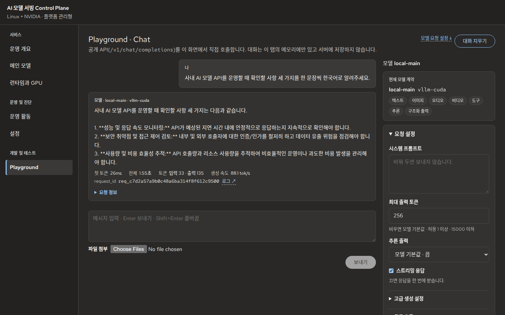
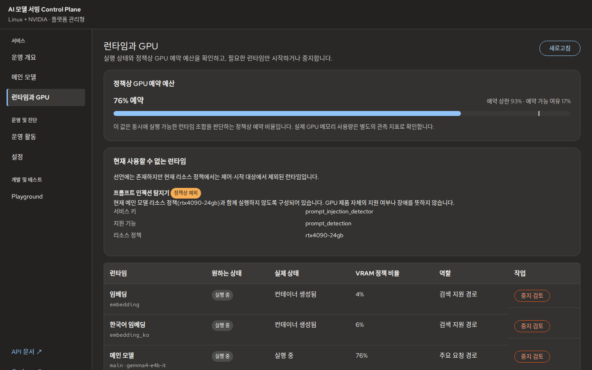
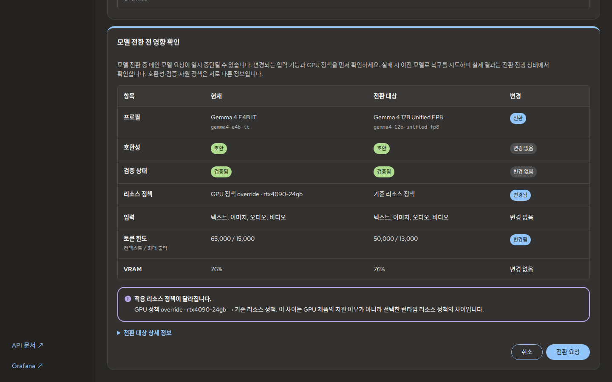
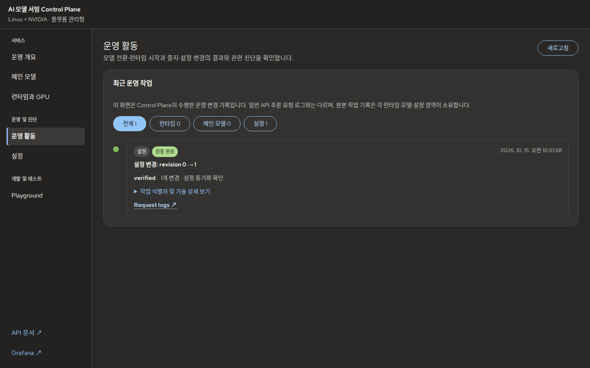

# 사용자 가이드: 상태 확인부터 운영·복구까지

처음 설치한다면 [빠른 시작](getting-started.md)을 먼저 완료하세요.
API를 연동하는 사용자는 [API 연동](api-integration.md), 저장소를 수정하는 개발자는
[개발자 가이드](developer-guide.md)로 이동합니다.

<a id="access-and-auth"></a>

## 1. 접근 범위와 인증 확인

**목표:** 접속 위치에 맞는 접근 범위와 키를 사용합니다.
**사전 조건:** 운영자가 Gateway 주소와 사용자 권한을 안내해야 합니다.

| 접근 의도 | 선택 | 접속 경계 |
|---|---|---|
| 같은 컴퓨터 | `ACCESS=local` | loopback, 기본적으로 API/Admin 인증 비활성화 |
| 신뢰된 LAN/VPN | `ACCESS=private` | Gateway 인증 필요, 인터페이스·TLS는 운영자 책임 |
| 같은 호스트의 TLS edge 뒤 | `ACCESS=edge` | loopback Gateway + 별도 edge proxy/TLS |

현재 값을 먼저 확인합니다.

```bash
make status
make auth-status
```

기존 설치를 private로 변경한다면 `make up ACCESS=private`로 계획을 읽고,
선택한 bind 주소·인증·TLS 구성을 검토한 뒤 `make up ACCESS=private CONFIRM=access`를 실행합니다.
edge 선택만으로 TLS proxy가 자동 설치되는 것은 아닙니다.
상세 정책은 [접근 설정](../05_configuration.md)과 [실행 모드](../04_runtime_modes.md)가 소유합니다.

| 값 | 사용할 곳 | 누구에게 받나 |
|---|---|---|
| 사용자 API Key | `/v1/*`, Playground의 공개 API 인증 | 플랫폼 운영자 |
| Admin Key | Console 관리자 인증, `/admin/*`, 운영자 probe | 플랫폼 운영자 |
| Internal Service token | 내부 서비스 간 통신 | 운영 설정이 관리; 사용자 클라이언트에 전달하지 않음 |
| Hugging Face token | 모델 다운로드 | 해당 모델 이용 권한을 가진 운영자 |

**성공 기준:** Console을 열고 관리자 작업을 조회할 수 있으며 Playground의 공개 요청도 허용됩니다.
키는 현재 브라우저 탭 메모리에 유지되어 새로고침하면 다시 입력해야 할 수 있습니다.
**실패 시:** 401이면 사용하는 키의 종류와 현재 profile을 확인합니다. local에서 인증 화면이 없는 것은
설정에 따른 동작입니다. 인증을 끄는 방식으로 오류를 우회하지 않습니다.

## 2. 서비스 확인

**목표:** 요청을 보낼 준비가 되었는지 파악합니다.
**사전 조건:** `make up` 완료 후 Console에 접속합니다.

1. **운영 개요**에서 메인 모델의 요청 상태와 Runtime 관측 상태를 확인합니다.
2. 최근 요청 집계를 보고 오류가 있는지 살펴봅니다. 조회 실패와 모델 장애를 구분합니다.
3. **모델 응답 테스트** 또는 메뉴의 **Playground**로 이동해 실제 요청을 보냅니다.


*기존 실제 화면(2026-10-15). 현재 UI의 지표·빠른 작업 위치는 최신 운영 UX를 따릅니다.*

**성공 기준:** 상태 확인과 별도 실제 응답이 모두 성공합니다.
`healthy`, `gate open`, `compatible`, `qualified`는 서로 다른 정보입니다.
“조회된 주의 항목 없음”을 추론 성공이나 무장애 보증으로 해석하지 않습니다.
**실패 시:** [오류 복구](#recovery)에서 request ID와 최근 작업을 확인합니다.

## 3. Playground 사용

**목표:** 지원되는 입력으로 실제 응답을 테스트하고 요청을 재현합니다.
**사전 조건:** 현재 모델이 Chat을 지원하고 요청 Gate가 열려 있어야 합니다.

1. 상단의 현재 모델과 입력 기능을 확인합니다.
2. 예제를 골라 미리 보고 **입력에 적용**합니다. 기존 작성 내용의 교체 확인이 뜨면 검토합니다.
3. **보내기**를 눌러 실행합니다. 이미지·오디오 등은 모델이 허용하는 형식·크기 안에서 첨부합니다.
4. 응답·요청 정보와 request ID를 확인합니다. 필요하면 **중지**를 누를 수 있습니다.
5. 각 응답의 **코드로 사용하기**에서 해당 요청을 내보냅니다. [API 연동 절차](api-integration.md#replay)로 이어집니다.



*2026-10-15 기록. 현재 예제 선택·요청 내보내기 기능은 [Playground 예제](../reference/control_plane_playground_examples.md)와
[요청 재현](../reference/playground_integration.md)을 참고합니다.*

**성공 기준:** 응답이 정상 종료되고 전송 당시의 요청 정보를 확인할 수 있습니다.
`STREAM_INCOMPLETE`이면 받은 일부 내용만 남은 것이므로 완전한 답변으로 사용하지 않습니다.
Tool 호출이 나오면 실제 함수 실행 결과를 수동으로 입력해 이어갑니다. Console이 함수를 자동 실행하지 않습니다.
**실패 시:** 미지원 예제의 이유, 422 오류와 모델 제한을 확인합니다. 긴 reasoning만 나오면
현재 reasoning 설정과 출력 토큰 한도를 확인합니다. [실제 GIF 예시](../reference/feature_demos.md)는 한 번의 실행 기록입니다.

<a id="runtime-states"></a>

## 4. Runtime과 GPU 운영

**목표:** 필요한 Runtime을 자원 정책 안에서 실행하거나 중지합니다.
**사전 조건:** Linux/NVIDIA managed target과 운영 권한이 필요합니다. Static Main은 외부 lifecycle을 따릅니다.



*2026-10-15 실제 화면. GPU 비율은 정책상 예약값이며 VRAM 실측이 아닙니다.*

| 관찰 상태 | 의미와 다음 행동 |
|---|---|
| 실행 중, 요청 준비됨 | 해당 Runtime을 사용하는 실제 요청으로 확인 |
| 중지됨 | managed target의 시작 검토 → 영향 확인 → 적용; 기동 검증 완료까지 대기 |
| 시작 중 | 진행 상태와 `make logs` 확인; 완료 전에 같은 작업을 반복하지 않음 |
| 원하는 상태와 실제 상태가 다름 | 실제 container 관측·작업 결과 확인; 의도만으로 실행 성공을 단정하지 않음 |
| 정책상 제외 / 사용 불가 | 현재 자원 정책에서 제외된 기능; GPU 고장으로 해석하거나 강제로 우회하지 않음 |
| 메뉴 자체가 없음 | target capability 확인; static target의 모델·Runtime 제어는 외부 소유 |

시작·중지는 **검토 → 적용 → 검증 결과 확인** 순서로 진행합니다. 자동 중지가 필요한 다른 Runtime이
표시되면 서비스 영향을 검토하세요. 상태가 바뀌어 계획이 낡았다면 새로 계산합니다.
**성공 기준:** 원하는 상태와 관측 상태가 수렴하고, 시작했다면 관련 API 요청이 성공합니다.
**실패 시:** budget 부족·기동 오류·검증 실패를 구분합니다. 실제 GPU 메모리는
[Grafana 관측](../11_observability.md)으로 확인합니다. 상세 권위와 API는 [모델 운영](../06_model_operations.md)을 따릅니다.

## 5. 메인 모델 변경

**목표:** 변경 영향을 확인하고 전환 후 새 모델의 응답을 검증합니다.
**사전 조건:** managed target, 전환 가능한 profile, 적합한 resource policy와 운영 권한이 필요합니다.

1. **메인 모델**에서 현재 profile과 후보의 입력 기능·토큰 한도·자원 정책을 비교합니다.
2. **전환 검토**에서 중단 가능성과 기능 감소, 검증 상태를 읽습니다.
3. 해당 호스트에서 허용된 경우에만 **전환 요청**을 수행합니다.
4. 진행 상태와 실제 완료·실패·복구 결과를 확인합니다.
5. 완료 후 Playground에서 새 요청을 보내 별도로 응답을 확인합니다.



*전환 전 검토 화면(2026-10-15). 이 캡처는 실제 12B 전환 성공 기록이 아닙니다.*

Runtime 시작·중지와 Configuration 변경은 Plan/Apply 계약을 사용합니다. Main Model 변경은
전환 검토와 Main Model switch 계약을 따릅니다. 모두를 동일한 Plan API로 설명하지 않습니다.
**성공 기준:** 활성/관측 profile과 Gate를 확인하고 새 모델의 응답까지 성공합니다.
**실패 시:** 이전 모델로 복구했는지, Gate가 닫혔는지 확인하고 [모델 전환 복구](../06_model_operations.md)로 이동합니다.

## 6. 설정 변경과 작업 기록

**목표:** 현재 값의 출처를 알고 변경 결과를 확인합니다.
**사전 조건:** Console의 해당 항목이 편집 가능하며 운영 권한이 있어야 합니다.

1. **설정**에서 적용 값·출처·수정 가능 여부를 확인합니다.
2. 편집 후 변경 검토에서 변경 전후 값·위험을 읽고 적용합니다.
3. 적용 결과의 동기화·검증 상태를 확인합니다.
4. **운영 활동**과 설정 변경 이력에서 실제 작업을 찾습니다.



*2026-10-15 촬영용 Gateway에서 수행한 실제 설정 변경 1건. 일반 추론 요청 로그나 모델 전환 성공 기록이 아닙니다.*

**성공 기준:** 새 값과 동기화된 결과를 확인합니다.
**실패 시:** stale plan이면 다시 검토합니다. 이전 값 복원도 새 변경이므로 검토 후 결과를 확인합니다.
[설정 변경·복원 상세](../reference/configuration_history_rollback.md)를 참고하세요.

<a id="recovery"></a>

## 7. 오류 복구와 안전한 종료

**목표:** 원인을 좁히고 복구 후 실제 응답을 확인합니다.
**사전 조건:** 오류 코드, request ID 또는 operation ID를 확보합니다.

```bash
make status
make logs
```

필요한 경우 `make logs SERVICE=gateway RAW=1 TAIL=100`으로 raw Gateway 로그를 조회합니다.
서비스 ID와 로그 탐색 옵션은 [운영 관리](../12_operations.md)를 따릅니다.

| 증상 | 우선 확인 | 다음 조치 |
|---|---|---|
| 접속 불가 | `make status`, 출력된 Gateway 주소·bind | Docker/프로세스·포트 확인 후 `make up`으로 수렴 |
| 401 | 키 종류와 접근 설정 | 운영자에게 올바른 키 확인 |
| 422 | 오류의 field와 `/v1/models` 제한 | 입력·파라미터 수정 후 재요청 |
| Runtime 중지 / `MODEL_UNAVAILABLE` | 원하는 상태와 실제 상태 | 해당 Runtime의 시작 검토·검증 |
| `DETECTOR_DISABLED` | target와 effective topology | 현재 제공되지 않는 탐지 기능임을 확인 |
| Gate 닫힘 / 모델 불일치 | 메인 모델 상태·최근 operation | 원인 해결과 실제 검증·복구 결과 확인 |
| `STREAM_INCOMPLETE` / 스트림 오류 | 받은 내용, request ID, Gateway 로그 | 부분 응답을 완료로 쓰지 말고 원인 확인 후 새 요청 |

로그·설정을 공유하기 전에 키·입력 원문·내부 주소를 확인하세요.
원인을 수정한 뒤 `make up` → `make status` → Playground/API 요청 순서로 복구를 확인합니다.
일반 종료는 `make down`입니다. Reset/Purge의 범위와 확인 절차는 [운영 관리](../12_operations.md)를 참고하세요.
